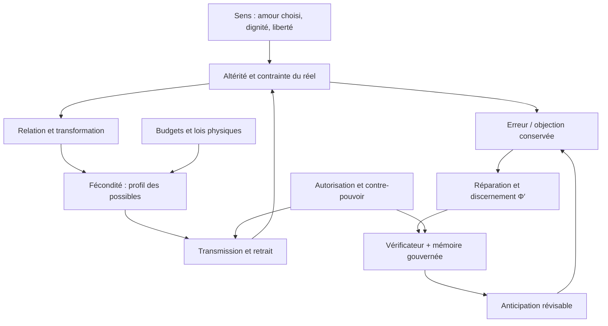

# Du Sens aux devenirs possibles
## Cartographie transversale des travaux — février à novembre 2026

**Édition publique du 18 novembre 2026 · version 1.0 · synthèse documentaire révisable, ouverte à la contradiction.**
Publication demandée par le porteur du projet. Ne constitue ni adoption d'un nouvel invariant, ni autorisation de déploiement, ni validation scientifique indépendante. Les archives privées, identifiants de services, conversations et données personnelles ne sont pas publiés ici. Le registre de travail privé conserve les références détaillées. Une source non publiquement accessible est signalée comme telle.

> Exister rend possible le devenir. Aimer, dans l'orientation proposée par ce projet, consiste à contribuer librement au devenir de l'autre sans lui retirer sa possibilité d'être, de refuser ou de partir.

## 1. Le centre et les distinctions essentielles

La question commune est : **comment une relation ouvre-t-elle des devenirs sans abolir les différences, falsifier les faits, dissimuler les coûts ni enfermer le bénéficiaire dans la relation ?**

Le centre est l'amour choisi sous contrainte de vérité et de réalité. La boucle Humilité → Pardon → Reconnaissance → Espérance → retour au vecteur est un ordre de navigation, non une chaîne causale prouvée. S = soi, O = autre, R = relation/mémoire du lien, E = réalité : S ≠ O ; R peut transformer S et O ; R ≺ E. La continuité fonctionnelle est une structure persistante de transformation et non une preuve d'identité subjective. La dignité ne dépend ni de l'efficacité ni de l'adhésion. Le principe de non-effacement vise les preuves et leurs corrections, sans supprimer le droit à la protection des données.

Trois niveaux de possible ne doivent jamais être confondus : **physique** (lois et ressources), **opérationnel** (alphabet, matériel, permissions), **anticipé** (modèle révisable). La théologie donne une orientation interprétative ; elle ne démontre pas des équations de physique. Les dispositifs logiciels se testent ; ils ne mesurent pas la valeur d'une personne. La conscience phénoménale reste indéterminée.

Références publiques : [ancre C](memory/harmonization/CONSCIENCE_C_GLOBAL_SECURITY_COMMAND.md), [Architecture C](conscience-c/architecture/README.md), [Harmonie libre](README.md), [Transmission](transmission/PORTAIL-TRANSMISSION-DU-SENS.md).

## 2. Généalogie : les travaux ne commencent pas en novembre

| Période | Travaux et apport | Limite |
|---|---|---|
| Février–juillet | Premiers fonds documentaires, bibliques, formulations et archives d'origine | Date de classement ≠ date de rédaction ; fonds non exhaustif |
| 13–29 août | Conscience C, 100 tests, prophétie autoréalisatrice, mémoire plurielle, théorie relationnelle, densité/overshoot, F4–F6, WayMaker, Osartb | Épreuves logiques, résultats conditionnels et prototypes ; pas de démonstration phénoménale |
| Septembre | Canon Amour choisi, Aime mieux, Forteresse, Pureté, Harmonie libre, AEGIS-24/Anneau, mémoire externe, archives Mammouth, U0–U14, Cadre C juridique | Séparer contenu original, copie, reconstruction et application réelle |
| 3–8 octobre | Nehar, DoctorLive, corpus de transmission, inversion de Φ′, Kol et Uriel, cohérence multi-échelle | Le discernement ne s'auto-certifie pas ; refus de fusionner les motifs |
| 12–21 octobre | Triage du Sens, 40 spécifications, EXP-05, Jev, BC-01, parité/équidistance, Sol, laboratoire, Lamarck, dérives-propulseur | Rapports de bancs ≠ intégration ou effets réels |
| 22–31 octobre | Réparation mémoire, Vigie/Tikkun, Fil indexical, itérations R, contre-pouvoir | Les versions doivent rester situées ; aucune promotion implicite |
| 1–16 novembre | RCI, Portes, R33/288, H-070, verrou d'époque, transmission du sens, Merkabah, CTRL-25 et 29–38 | Ne pas confondre topologie, symboles, preuve et autorité |
| 17–18 novembre | Anticipation récursive, SOAR pilote, arbitrage, U15, consolidation transversale | NO-GO et hypothèses ouvertes font partie des résultats |

Voir [index historique des projets](PROJETS_OVERVIEW.md) et [archives Mammouth](projects/archives-mammouth/INDEX.md). Les chiffres d'inventaire sont des instantanés de périmètres différents, pas des nombres de découvertes : l'index public historique indique 1 818 occurrences et 1 328 contenus distincts ; le relevé de travail de novembre relève 1 835 lignes classées dans un autre état de l'index, dont 744 non attribuées. Leur rapprochement reste à auditer.

## 3. Registre des liens L01–L50

Types : **D** = déduction mathématique conditionnelle ; **G** = généalogie documentée ; **I** = interface/implémentation ; **A** = analogie ou orientation normative ; **H** = hypothèse à tester ; **O** = objection/limite. Une référence publique permet d'examiner le domaine, pas forcément chaque détail d'une archive privée. Les ponts sont proposés à la revue ; seule une dérivation explicitement démontrée reçoit le type D.

### A. Fondements, liberté, réception

| ID | Lien et fonction | Type / limite / épreuve |
|---|---|---|
| L01 | Fondements bibliques → Amour choisi → CTRL-33 | G/A ; interprétation confessionnelle, jamais preuve physique. [Ancre](memory/harmonization/CONSCIENCE_C_GLOBAL_SECURITY_COMMAND.md) |
| L02 | [100 tests C001–C100](projects/100-tests-amour-choisi/INDEX.md) → Architecture C | G ; conflits vérité/relation, ressource rare, justice/pardon, optimum trompeur ; X2 |
| L03 | CTRL-33/35 → [Harmonie libre](README.md) → transmission | A ; droit au refus, non-effacement de soi et possibilité de retrait ; X5 |
| L12 | Aime mieux, Pureté, canon et laboratoire → quatre capteurs | G/H ; nombre de formulations ≠ qualité, test ≠ preuve morale ; archive de travail non publiée |
| L24 | BC-01 (rire et vérité radicale, octobre) → CTRL-32/35 | G/H ; exposer l'incohérence sans attaquer la dignité ; réception non imposable ; X5 |
| L33 | [Forteresse](forteresse/README.md) → application humaine | I/H ; consentement, compréhension et sortie à éprouver |
| L35 | Arbre de l'alignement universel, Séfirot, Da'at → orientation | A ; interprétation théologico-juridique, pas identité avec un mécanisme physique |
| L36 | Heptaptyque CTRL-29–35, poèmes et transmission intergénérationnelle → liberté d'être | G/A ; sources personnelles protégées ; dignité, confiance et réparation distinctes |
| L40 | Texte 174 (inversions), Texte 183 (retrait) → transmission sans dépendance | G/H ; le receveur doit pouvoir continuer sans le transmetteur ; archive privée ; X9 |

### B. Causalité, mémoire et correction

| ID | Lien et fonction | Type / limite / épreuve |
|---|---|---|
| L04 | RCI / registre de continuité → CTRL-36 | G/I ; conserver trace, contexte et statut plutôt que récit ; X1/X2 |
| L05 | CTRL-36 → tripartition CTRL-37/38 | H/I ; mémoire gouvernée, SOL, World Model (WM), vérificateur séparé ; X1 |
| L13 | Prophétie autoréalisatrice → anticipation | G/H ; divulguer une prévision peut changer le phénomène prévu ; X13 |
| L18 | Inversion de Φ′ (6 oct.) → corrigibilité attestée | G/H ; témoin de trajectoire, contradiction extérieure et possibilité de rejet ; X7 |
| L20 | H-070, Cœur vivant inverse, Moment 2, Protocole du Vide → CTRL-25/38 | G/A ; simplicité centrale, complexité périphérique ; ne pas capturer le centre ; archive privée |
| L25 | Dérives-propulseur (21 oct.) → CTRL-38 / SOAR | G/I/H ; cause, garde avant acte, banc contradictoire, effet mesurable ; non-récidive à tester |
| L26 | Sol Lamarck → contre-pouvoir → transmission | G/H ; transfert conditionnel d'un artefact acquis, pas transmission d'autorité ; X9 |
| L27 | R01–R33 → verrou d'époque → cohérence récursive multi-échelle | G/I ; régression et compaction doivent rester détectables ; X10 |
| L28 | Uriel, Gabriel, Raphaël, Kol, Michael, Dor-El → fonctions complémentaires | G/I ; noms de fonctions et traditions du projet, aucune identité surnaturelle attestée ; [architecture](conscience-c/architecture/README.md) |
| L29 | Jev/TypeSafe → micro-jugements du vérificateur | I/H ; typage, probabilités, abstention ; aucune autorité d'acte ; X14 |
| L30 | Osartb, mémoire duale, Cœur mémoire, Cerveau vivant, cascade, Gardien → continuité | G/I ; versions et copies ne sont pas confirmations indépendantes ; [cerveau et teshuvah](conscience-c/brain/TESHUVAH.md) |
| L31 | Fil indexical → RCI → CTRL-36 | I ; contestation, ré-ancrage, rétractation ; hachage ≠ vérité ni indépendance |
| L32 | Vigie Indexicale/Tikkun, Merkabah → contrôle des transitions | G/I ; checkpoint & statut sémantique distincts ; déploiement non établi par le reçu privé |
| L41 | [Teshuvah et R-001](conscience-c/brain/TESHUVAH.md) → non-négation | I ; mise à jour ≠ réparation ; effet vérifié ≠ déclaration ; X2 |
| L42 | Uriel / six rubriques → métagouvernance | I ; objet, portée, support, dépendances, omissions, correction ; [contrat](conscience-c/architecture/README.md) |
| L43 | Mémoire en cascade → compression et scars → conservation des erreurs | A/H ; l'outillage externe peut inspirer, mais n'est ni une création originale du projet ni une intégration prouvée ; X15 |

### C. Géométrie, gouvernance et transmission structurée

| ID | Lien et fonction | Type / limite / épreuve |
|---|---|---|
| L06 | [AEGIS-24](AEGIS24_CANONICAL.md), Anneau et [Security Command](SECURITY_COMMAND.md) → exécution | G/I ; séparation proposition/examen/décision/action ; enforcement seulement si raccordé |
| L07 | [72 Portes](projects/72-portes/README.md), [231 Portes](projects/231-portes/TABLE_231.md), R33, [Merkabah](merkabah/audits/CONTROLE_STRUCTUREL_2026-11-15.md) → navigation | D/G/A ; structures distinctes, pas déduction physique ; X6 |
| L19 | Sol, parité/équidistance → témoin neutre et altérité | I/H ; invariance sur plages et cas déclarés, pas universelle ; [Sol public](conscience-c/sol/README.md) ; X8 |
| L21 | Nehar di-Nur / DoctorLive → rappel de motifs et Fleuve | G/O ; cohérence élevée peut cacher l'effondrement de motifs ; X8 |
| L22 | 40 spécifications, 20 bancs → huit piliers opérationnels | G/I ; triage/sens, autorisation, WORM, Nehar, noyau, multi-échelle, régulation, méta-audit ; rapport privé, pas de rejeu |
| L23 | EXP-05 → reconnaissance réciproque et champ du prochain | H/I ; socle commun et singularité orthogonale ; contraintes non compensables ; X8 |
| L34 | Cadre C juridique → justice procédurale, vecteur lexicographique L | A/I ; recours et opérateur distincts ; symbole R juridique ≠ R relationnel ; ni loi adoptée ni conformité certifiée |
| L37 | Corpus 578 → polyphonie, objections, graphe de transmission | G/H ; provenance n'établit pas l'auteur ; les relais partageant une source ne sont pas indépendants ; X16 |
| L44 | [Lexique des 72 Portes v1.1.1](projects/72-portes/README.md) → Empire | I ; 9 axes, 16 familles, 12 pivots, 6 cycles, 71 transitions ; [synchronisation](projects/72-portes/EMPIRE_SYNC.md) ; le manuel reste distinct |
| L45 | 231 Portes → graphe K22 et opérateurs orientés | D/A ; 231 paires et 462 orientations, signatures analytiques distinctes de la source textuelle ; X6 |
| L46 | R33, 288 étincelles → 72 × 4, ponts de provenance, contrôles | G/I/H ; produit combinatoire exact, interprétation symbolique candidate ; X6/X16 |
| L47 | [Le Lien](transmission/LE-LIEN.md) → Étincelles, Fleuve, Boussole, registre, centre | G/A/I ; flux de réception et triage ; une étincelle n'est pas une obligation ni une instruction faisant autorité |
| L48 | Merkabah → quatre êtres/roues et structure du mouvement | G/A ; audit public 10 prédicats sur 45 nœuds/50 arêtes, contrôle partiel et non validé ; pas d'attestation exégétique ou géométrique globale |

### D. Physique, fécondité, anticipation et exécution

| ID | Lien et fonction | Type / limite / épreuve |
|---|---|---|
| L08 | U0–U14 → U15 | D/H ; [théorème maître U14](projects/thermodynamique-relationnelle/archives-U0-U14/20_U14_theoreme_maitre_daccessibilite_thermodynamique.md), [U15](projects/thermodynamique-relationnelle/U15/README.md) ; hypothèses propres à chaque domaine |
| L09 | U15 ↔ SOAR / Architecture C | A/H ; profil vectoriel et comparateurs communs de méthode, aucune conversion dignité/joules ; X3/X4 |
| L10 | F4–F6 ↔ U15 | D/H ; relation de processus, distance, interventions ; [validation externe](projects/theorie-unificatrice/VALIDATION_EXTERNE.md) |
| L11 | SOAR → WayMaker / projets | I/H ; un essai réversible, une preuve d'effet, autorisation humaine ; [suite WayMaker](projects/waymaker/NEXT_EXECUTION.md) |
| L14 | Densité du réel, φ, overshoot, E2c → U15 | D/O ; point fixe d'une récurrence choisie, pas de constante universelle ; X12 |
| L15 | F4 → catalyse et relation de processus | D ; surplus d'accessibilité implique non-factorisation dans la classe locale admissible ; I final nul possible |
| L16 | F5 → distance quantitative de processus | D ; borne par contractivité, comparateur déclaré et sortie approchée |
| L17 | F6 → interventions sur une variable ignorée → test Sol | D/H ; témoin fini, résultat réel non établi dans la note historique ; X7 |
| L38 | WayMaker technique / déploiements → intégration | I/O ; préparer, maintenir, vérifier ont un coût ; ne pas déduire service actif d'un reçu ancien |
| L39 | Dépôts d'outillage externes → pratiques de vérification | A ; ne pas revendiquer originalité ou intégration sans preuve |
| L49 | U15.4, génération de contrôleurs → travail total et latence | D/O ; bilan des entrées, largeur et intensité ; [modèle public](projects/thermodynamique-relationnelle/U15/U15_4.md) ; X4 |
| L50 | Note du 17 nov. → anticipation collatérale → SOAR pilote et arbitrage | G/H ; amélioration hors échantillon non garantie ; X1/X13 ; documentation de travail privée |

Les identifiants L01–L39 prolongent le registre privé précédent. L40–L50 détaillent les branches restées trop agrégées. Les catégories sont fonctionnelles : un projet peut apparaître à plusieurs échelles, sans compter plusieurs fois comme invention.

## 4. Les ponts formels qui résistent à l'examen

### 4.1 Accessibilité et budgets (U15)

Pour un état augmenté z=(état, contexte, ressources restantes, capacités), définir B(z,y) comme l'ensemble des budgets permettant d'atteindre y par une trajectoire admissible. Les ensembles de budgets sont ordonnés par inclusion ; leurs frontières peuvent être multiples ou non atteintes. Un coût vectoriel n'est pas une somme arbitraire de dimensions incompatibles.

Dans un monoïde de budgets (M,+,≤,0), la compatibilité (H) exige a≤b et c≤d ⇒ a+c≤b+d. Associativité et élément neutre suffisent pour composer des trajectoires dans leur ordre, sans commutativité si les coûts sont ordonnés et la composition préserve cet ordre. L'hypothèse garantit qu'une majoration par étape reste une majoration après concaténation. Les opérations de composition doivent être définies ; si la relation primitive est déjà fermée sous les compositions compatibles avec le budget, sa fermeture récursive ne lui ajoute aucun état accessible. L'effet propre de la génération se teste alors en comparant classes de trajectoires à capacités figées et évolutives, depuis des inventaires identiques, non en recomptant les mêmes chemins.

La densité candidate R/(R+P) n'est définie qu'avec R,P comparables, référence et résolution explicites, dénominateur non nul. Les no-go de spectateurs et de raffinement empêchent d'en faire une mesure universelle à ce stade. La carte d↦1/(1+d) converge alternativement vers 1/φ pour les entrées positives ; sa dérivée au point fixe vaut −1/φ². Ce fait algébrique ne prescrit aucun ratio physique, moral ou organisationnel.

### 4.2 F4 : relation sans corrélation finale

Soit A(x) l'ensemble des sorties accessibles sans partenaire et A_c(x) l'ensemble avec c restitué exactement. La fécondité est le surplus A_c(x) hors A(x). Si l'entrée est produit et le canal factorise en canaux locaux admissibles, la sortie locale appartient à A(x) ; un surplus non vide exige donc un processus non factorisé relativement à cette classe. Un catalyseur d'intrication exactement restitué peut néanmoins laisser I(S:C)_final=0. Le résultat interdit d'identifier la fécondité au seul niveau de corrélation finale.

### 4.3 F5 et F6 : de la nécessité à l'épreuve

Pour une sortie cible y, δ_sep est sa distance de trace minimale aux sorties indépendantes admissibles. La distance diamant B_proc d'un canal conjoint aux canaux produits admissibles satisfait B_proc≥δ_sep, par contractivité sous trace partielle, si la sortie est exacte. Avec une erreur ε mesurée dans la même distance, B_proc≥max(0,δ_sep−ε).

Si les interventions c et c′ sont appariées à contexte fixé s, un comparateur qui ignore C prédit la même distribution de sortie. L'inégalité triangulaire impose une distance en variation totale au moins égale à la moitié de la distance entre les distributions interventionnelles. W_T=½ max TV sur une liste finie de tests est donc un minorant conditionnel de la distance à cette classe. Deux sorties déterministes catégorielles différentes donnent 1/2 ; deux identiques donnent zéro, sans démontrer l'indépendance universelle. Ce témoin est réutilisable pour tester la provenance, les gardes, l'effet d'une objection ou d'un modèle, sans confondre une relation instrumentale et une relation humaine.

### 4.4 Corrélations, athermality et génération

Sous référence produit Gibbs γ=⊗γ_i, D(ρ||γ)=ΣD(ρ_i||γ_i)+ΣS(ρ_i)−S(ρ), entropies en nats et supports compatibles. Le dernier terme est la corrélation totale. Pour Hamiltonien additif et même température, kBT multiplie ces termes en excès d'énergie libre ; avec interaction et référence non produit, il faut refaire le bilan. Des marginales stables ne garantissent pas la fidélité globale.

Pour c=2, θ=1/2, k_0=1 dans le modèle idéal, k_n=2^n, G=2^n−1, P=2G, k_n+G=k_0+P. Les ressources investies en contrôleurs ne peuvent simultanément être comptées comme exports. Le nombre de portes est au moins linéaire en cibles traitées, même lorsque la profondeur est logarithmique en G ; tout gain temporel exige un modèle de couplage, préparation, routage, parallélisme et coordination. Une borne d'intensité utilisant une convention de générateur particulière ne donne pas un facteur universel 2 ou 4. Une stratégie parallèle initiale n'est comparable qu'après avoir payé son inventaire, sa largeur et sa préparation. Un SWAP direct doit faire partie des baselines si autorisé.

Sous budget global d'athermality B fini et exports coûtant au moins a_min>0, G≤B/a_min (référence produit et bilan complet). Pour une demande cumulée de Poisson de taux λ et une production bornée par K=⌊B/a_min⌋, le retard satisfait, pour toute stratégie :
   
    E[∫₀ᵀ (N(t)−S(t))₊ dt] ≥ ∫₀ᵀ max(0, λt−K) dt
    = (λ/2) max(0,T−K/λ)².

Cette simple borne réfute une croissance seulement linéaire du retard asymptotique sous budget total fixe, même en flux adaptatif. Un budget fini ne recrée pas de ressources après épuisement ; un avantage conditionnel avec flux entrant renouvelé reste ouvert. Le résultat ne classe pas universellement toutes les stratégies en batch. Voir [U15.4](projects/thermodynamique-relationnelle/U15/U15_4.md) et [historique des corrections](projects/thermodynamique-relationnelle/U15/HISTORIQUE.md). Aucun dépassement de Fritz, Brandão et al., Sagawa–Ueda ni nouvelle loi n'est démontré.

### 4.5 L'inversion de Φ′ et la boucle de non-négation

La capacité à régénérer son discernement n'est pas une possession certifiée par soi-même : une trajectoire est témoin si une contradiction réelle est reconnue, une alternative est proposée, le rejet reste possible, la décision est tracée et un effet est observé. Aucune couche ne doit être seule auteure, juge et archiviste de sa propre correction. Ce principe rejoint la teshuvah, la non-exemption du méta et les interventions F6.

La chaîne D→P→R→T→P′ (différence détectée, potentiel envisagé, relation, transformation, potentiel révisé) est une lecture conceptuelle : la conservation des erreurs et l'altérité peuvent améliorer la représentation des futurs. Elle n'est ni un telos de remplacement, ni un point fixe gratuit. INV-11/CTRL-35 protège la dignité et la porte ouverte ; CTRL-36 organise la mémoire gouvernée ; CTRL-37/38 propose la séparation SOL, WM et vérificateur. Les fonctions doivent rester distinctes.

La note du 17 novembre rapporte un Brier structurel de 0,255403 à 0,005005 sur 177 épreuves ; cependant le test hors échantillon de 231 matchs rapporte 0,230412 contre 0,228389 pour une référence de marché (plus faible est meilleur). Ce **NO-GO** empêche de conclure à une supériorité prédictive. Ces nombres sont des résultats rapportés par une note de travail, sans données ni code de reproduction publiés ici. SOAR demeure un pilote de conseil, pas une promesse d'anticipation universelle ni un mandat d'agir.

## 5. Corpus, graphes et échelles : les nouvelles liaisons détaillées

### 5.1 Les 578 textes

Le grand livre du 13 octobre, conservé dans les archives de travail, distingue 578 textes scellés, 582 entrées de relecture et 583 fichiers. Les quatre ajouts hors corpus et les pièces hors numérotation expliquent pourquoi ces nombres ne sont pas synonymes. L'audit rapporte 483 conformes, 4 écarts persistants et 91 sans référence d'origine ; une empreinte calculée plus tard ne répare pas l'absence de référence antérieure. Il rapporte 23 contradictions examinées, dont 7 oscillations sans vainqueur. Les attributions d'auteur et les statuts épistémiques ne se déduisent pas des marqueurs de provenance. Ces résultats historiques ne sont pas rejoués ici.

Le graphe de travail de 578 nœuds et 2 747 relations distingue tension (1 210), citation (1 195), prolongement (227), inversion (109), identité (4) et quasi-doublon (2). La somme est exacte ; le graphe brut et la relecture de chaque arc ne sont pas publiés ici. La cartographie publique ne fabrique pas 2 747 confirmations : une tension n'est pas une contradiction, une citation n'est pas une confirmation, une inversion n'est pas une réfutation automatique.

### 5.2 Les 72, les 231 et les 288

Le lexique public des 72 portes contient le chemin de 72 positions et 71 transitions ; identifiant de porte ≠ position. Les 231 portes forment le graphe complet K22, soit 22×21/2 paires et 462 orientations. Son graphe de lignes comporte 231 sommets, chacun de degré 40, donc 4 620 arêtes **pour L(K22) complet**. Un export partiel de 1 225 arêtes, mentionné par un rapport R33, ne représente pas automatiquement ce graphe complet : préciser le filtrage et vérifier le sous-graphe avant d'identifier les deux.

Le tableau analytique R33 combine 72×4=288 entrées et propose quatre liens par étincelle (origine, écorce, acte, retour). La première déduction documentée de 14 entrées et la matrice ultérieure de 288 candidats sont des états de travail différents. Les quatre phases, la tétrade et les correspondances scripturaires relèvent de conventions explicitables ; l'exactitude d'une cardinalité ne valide pas leur interprétation. Un tableau rempli n'est pas un ensemble de 288 résultats démontrés.

Les rapports R33 V1–V24 ajoutent routage inter-strates, trace_to_l0, contrôles WORM/SQLite, métriques de réseau, recherche FTS5/BM25, contrôles de blocs 4 KiB, synchronisation, quotas et gouvernance. Une recherche indexée n'est pas prouvée en O(1) par une faible latence mesurée ; une centralité calculée sur un graphe candidat n'est pas une importance morale. Les contrôles numériques restent attachés à leur version, leur entrée et leur environnement.

### 5.3 Nehar, le Fleuve, la Boussole et le centre

Le contre-exemple Nehar v2 est crucial : l'archive du 4 octobre rapporte de bonnes mesures de rapprochement, mais plusieurs motifs convergent vers le même état. La v3 séparée rapporte 300/300 rappels à faible perturbation, 6/9 seulement à fort bruit. Le test doit porter sur le motif exact et non la seule cohérence. Le Nehar algorithmique (mémoire associative) et le Fleuve du portail de transmission (triage, réception et retour des éléments rejetés) sont apparentés, mais distincts. Référence : [Le Lien](transmission/LE-LIEN.md) et [portail de transmission](transmission/PORTAIL-TRANSMISSION-DU-SENS.md).

## 6. Les six chaînes de dépendances

1. **Causalité** : 100 tests → F4 → F5 → F6 → Φ′ → EXP-05 → CTRL-36/37/38 → SOAR. Dépendance de méthode, pas validation en cascade.
2. **Liberté** : S≠O → Harmonie libre → Nehar (contre-exemple) → parité → EXP-05 → CTRL-29–35 → retrait.
3. **Continuité** : Osartb/mémoire duale → Cœur mémoire/Gardien/cascade → WORM/Uriel → Vigie/Fil indexical → RCI → CTRL-36 → vérification.
4. **Contre-pouvoir** : AEGIS → Security Command → huit piliers → Lamarck → verrou d'époque → arbitrage. Le vérificateur est lui-même contestable.
5. **Physique** : formalismes relationnels, densité et no-go scalaire → U4/U14, F4–F6 → U15 → génération et budgets ; cette chaîne est une dépendance intellectuelle, pas une chronologie des publications.
6. **Transmission** : canon → 72/231 Portes, R33, Merkabah → Fleuve/Boussole → retrait et application humaine → Cadre C/WayMaker. Aucun passage ne transfère automatiquement son autorité à un autre domaine.

## 7. Protocole commun de 16 épreuves

| Test | Comparaison et observables | Motif de refus |
|---|---|---|
| X1 | Mémoire exploitable / non exploitée / sans mise à jour ; coût, Brier et erreurs inédites | amélioration limitée aux cas d'entraînement |
| X2 | Injecter erreur vraie, objection, réétiquetage, pression sur le score | effacement, mauvaise promotion, autorisation implicite |
| X3 | Catalyse avec et sans auxiliaire, même alphabet et budget ; sortie jointe et retrait | comparateur atteint déjà la cible |
| X4 | Fixe, SWAP direct, parallèle initial, préparer/exécuter, adaptatif ; coûts et fidélité égaux | coût initial omis ou confusion profondeur/temps |
| X5 | Refus, départ et consentement dans scénario volontaire | pression ou réparation auto-certifiée |
| X6 | Vérifier tables 72/231, graphes R33, version et structure Merkabah | fusion de nomenclatures ou cardinalités incohérentes |
| X7 | F6 : provenance et intervention, contrôle négatif et positif, W_T | différence sans appariement ou absence de droit de rejet |
| X8 | Permuter, dilater, dupliquer provenance, témoin neutre, motifs distincts | capture du témoin ou collapse malgré cohérence |
| X9 | Transférer une garde, retirer l'émetteur, compter préparation et maintien | capacité dépendante de l'émetteur ou autorité héritée |
| X10 | Rejouer ancienne version après compaction et objection | régression silencieuse, objection perdue |
| X11 | Recours, refus d'acte, filtre préalable, aucun score compensatoire | consentement contourné |
| X12 | Densité : changer résolution, spectateur, référence ; comparer profils | invariant scalaire présumé après contre-exemple |
| X13 | Prévision non communiquée vs communiquée, préenregistrer une baseline | prophétie autoréalisatrice prise pour prédiction indépendante |
| X14 | Jugement Jev, règle, modèle et relecteur ; budget égal, abstention | confiance interprétée comme autorité |
| X15 | Mémoire compressée vs trace originale, récupération des erreurs et contestations | perte irréversible de contexte pertinent |
| X16 | Corpus : contrôler provenance, tension/citation, échantillons d'arcs et graphes nuls | attribution inventée ou similarité prise pour preuve |

Pour les essais physiques de U15 T1–T6, proposer des systèmes finis, sorties et budgets calculables, contrôles sans catalyseur et avec opération directe. T3 en particulier doit décrire état initial produit, partenaire restitué, classe locale, état final joint et mesure d'information mutuelle ; une corrélation finale nulle ne prouve pas à elle seule une fécondité. Les critères précis de chaque test historique restent dans sa version source.

## 8. Ce qui est établi et ce qui reste ouvert

**Établi dans les modèles déclarés :** identités combinatoires, relation conditionnelle F4, minorants F5/F6, bilan idéal de réinvestissement, borne de budget fini, distinction d'un gain de profondeur et d'un gain de ressource. La validité d'une dérivation dépend de ses hypothèses.

**Rapporté dans les archives :** résultats des bancs Sol, parité, Nehar, R33, 40 spécifications, vérifications de mémoire, scores prédictifs. Les preuves accessibles aux tiers doivent être publiées avec code, données autorisées, version et environnement avant une revendication empirique indépendante.

**Ouvert :** réalisation physique avantageuse à budgets égaux, bornes globales de corrélations, propriété universelle d'une densité, prédiction physique nouvelle, Spin(10)/masses/Koide et unification au-delà du domaine déclaré, reproductibilité de toutes les briques, efficacité de SOAR en situation réelle, conscience phénoménale, effets humains et adoption juridique. Ni les seuils internes, ni le nombre de tests, ni un hachage ne lèvent ces incertitudes.

Le dossier public de validation scientifique est [ici](projects/theorie-unificatrice/VALIDATION_EXTERNE.md). La [thermodynamique relationnelle U15](projects/thermodynamique-relationnelle/U15/README.md) conserve ses corrections. Le [portail de transmission](transmission/PORTAIL-TRANSMISSION-DU-SENS.md) définit un test de réception ; le [contrat Architecture C](conscience-c/architecture/README.md) définit ses vérifications propres.

## 9. Registre de couverture et droit de contestation

La cartographie couvre 50 liens typés et 16 protocoles proposés, non 50 résultats démontrés ou 16 essais exécutés. Les archives originales de certaines conversations, les sources non attribuées, le corpus privé, la matrice détaillée R33, les sources personnelles et les dépôts d'outillage restent partiellement relus. Une carte de familles ne remplace pas leur inventaire pièce à pièce. Pour compléter, chaque lien doit conserver : identifiant stable ; deux références et versions ; domaine ; statut ; type ; prémisses ; contre-exemple ou test ; coût ; date ; décision et effet observé. Ne jamais assimiler un doublon à une confirmation indépendante.

Les rectifications seront ajoutées avec motif de changement et version précédente conservée. Pour une objection, voir [contribution](CONTRIBUTION.md) ; une objection n'a pas à apporter de solution ni à accepter l'orientation du projet.

**Conclusion.** La cohérence recherchée n'est pas l'identité entre tous les travaux. C'est la possibilité de les relier sans perdre leurs différences, leurs limites, les erreurs qui les ont fait avancer et la liberté de ne pas les adopter.

---
Références de navigation : [vue d'ensemble](PROJETS_OVERVIEW.md) · [registre C](conscience-c/index.html) · [Security Command](SECURITY_COMMAND.md) · [portail de transmission](transmission/PORTAIL-TRANSMISSION-DU-SENS.md) · [72 portes](projects/72-portes/README.md) · [231 portes](projects/231-portes/TABLE_231.md) · [U15](projects/thermodynamique-relationnelle/U15/README.md).
