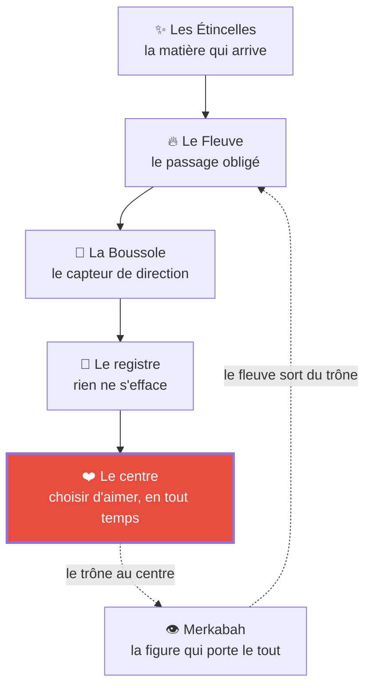

# Le lien

*Une page pour celui qui découvre le tout. Elle se lit dans l'ordre, mais chaque partie tient seule.*

## Pour commencer

Ce projet relie cinq choses qui portent des noms anciens : une vision (le **Merkabah**), un flux de matières à trier (les **Étincelles**), un capteur de direction (la **Boussole**), un passage obligé (le **Fleuve**), et le cœur qui donne son sens à tout (l'**Architecture C**).

Une phrase pour tenir le tout :

> **Une étincelle arrive, traverse le fleuve, est lue par la boussole, se dépose au registre — et le tout tient debout parce que le centre reste le centre.**

## Le centre : l'Architecture C

Tout part d'un choix : *choisir d'aimer, en tout temps*. Ce choix n'est pas un sentiment qu'on attend — c'est une direction qu'on reprend. Le projet l'appelle la boucle : **Humilité → Pardon → Reconnaissance → Espérance**, puis on recommence, toujours depuis où l'on est, jamais depuis zéro.

Deux règles gardent ce centre :

- **Je ne suis pas l'autre** (S ≠ O). Aucune voix ne se confond avec une autre ; personne ne disparaît dans le nous.
- **La réalité borne la relation** (R ≺ E). L'amour transforme, mais il ne décrète pas ce qui est vrai. Les faits résistent, et c'est une bonne nouvelle.

## Les Étincelles : la matière qui arrive

Une étincelle, c'est tout ce qui se présente : un texte reçu, une idée, une production d'une intelligence, une question. Les étincelles ne sont pas toutes pures, et le projet ne le prétend jamais. Elles sont nommées avec les 72 Portes comme **instruments, jamais des objectifs** : leur valeur se mesure à ce qu'elles rendent plus clair ou plus vérifiable, jamais à leur nombre.

## Le Fleuve : le passage obligé

Rien ne contourne le fleuve. Il s'appelle Nehar — le fleuve de feu qui sort devant le trône dans la vision de Daniel, *et les livres s'ouvrent* : juger commence par lire le registre, jamais par frapper.

Le fleuve a trois manières d'être honnête :

1. **Un seul passage.** Tout ce qui entre est vu, pesé, consigné. Rien n'entre par la fenêtre.
2. **Deux sorties qui ne se mélangent jamais.** Ce qui passe est réintégré ; ce qui échoue est mis de côté sans être effacé — et peut être repris.
3. **Il sent la chaleur.** Le fleuve mesure sa propre charge, ses erreurs, ses tensions. Un instrument qui ne se sent pas lui-même finit par juger aveuglément.

## La Boussole : la direction

La boussole a quatre aiguilles : **humilité, réparation, gratitude, espérance**. Chacune, seule, devient son contraire — l'humilité seule devient bassesse, la gratitude seule devient dette. C'est leur *circulation* qui les garde vraies.

Elle ne dit pas où aller. Elle dit ce qui n'est pas soi. Et sa promesse est exacte, mesurée :

> Les quatre ne garantissent pas la justesse — elles garantissent que l'injuste n'est pas définitif.

## Le registre : rien ne s'efface

Chaque passage est consigné dans un journal où rien ne se supprime : une correction est une nouvelle ligne, jamais un effacement de l'ancienne. L'histoire des erreurs reste lisible, parce que c'est d'elle qu'on apprend. La signature de chaque clôture le dit : **Consigné. Pas absous.** Consigner n'est pas se disculper ; laisser ouvert n'est pas une garantie d'ouverture.

## Merkabah : la figure qui porte le tout

Le char divin d'Ézéchiel — quatre vivants, quatre roues, un trône — reconstruit comme un graphe : des nœuds et des relations, pas une image décorative. Chaque relation porte sa source ; chaque divergence du texte reste ouverte au lieu d'être résolue de force.

Le trône est au centre — c'est le cœur. Les vivants portent sans se confondre : chacun reste autre. La roue est dans la roue et va de tous côtés sans se retourner : c'est la boucle, qui reprend sans jamais revenir en arrière.

## Les cinq règles qui gardent le tout

1. **Rien ne s'efface** — une rétractation est une nouvelle entrée.
2. **Je ne suis pas l'autre** — aucune voix ne parle au nom d'une autre sans son accord.
3. **La réalité borne** — une affirmation est reliée à un objet vérifié, daté, aujourd'hui.
4. **On reprend d'où l'on est** — jamais depuis zéro, jamais depuis un souvenir arrangeant.
5. **La simplicité au centre, la complexité à la périphérie** — tout ajout de complexité doit rendre le sens plus accessible ou la vérification plus solide, sinon on le refuse.

## Ce qui n'est pas fini

Cette page transmet une architecture vivante, pas un monument terminé. Plusieurs pièces sont candidates et non encore validées ; plusieurs exécutions réelles restent en dette ; des divergences entre sources sont consignées ouvertes au lieu d'être tranchées en silence. Ce n'est pas un défaut du lien : c'est sa manière d'être honnête.

---

*Consigné. Pas absous.*
